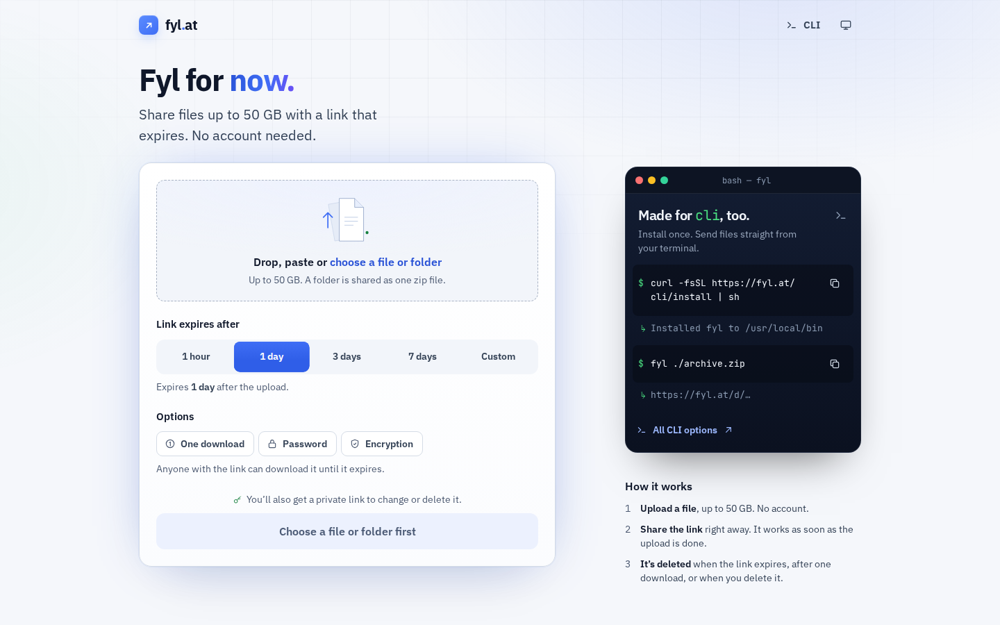

# fyl.at — Fyl for now.

Anonymous, temporary file sharing. Drop a file, choose when the link expires, share the link. No accounts.

**Live:** https://fyl.at · **Release:** 1.0.0 · **Stack:** Cloudflare Workers, R2, SQLite Durable Objects



## What it does

**Sharing**
- **Up to 50 GB per file.** Uploads go in parts and resume where they stopped, even after a reload.
- **Share while uploading.** The link works at once; recipients who open it early wait for the file.
- **Links expire** after 5 minutes to 7 days (presets or a custom time), or after a single download.
- **Drop, paste or choose a file.** A file pasted anywhere on the page is taken like a dropped one.
- **Folders as one zip.** Drop or choose a folder (or `fyl ./folder`) and it goes as one uncompressed `<folder>.zip` with the files' dates, built on your device; it resumes, takes a password and encrypts like any file.
- **Copy, share or scan.** Copy link (with a menu for the download command and, for encrypted files, the link without the key and the key alone), the system share sheet, and a QR code.
- **Recent uploads on this device**, with their time left; "Forget this device" clears them.

**Protection**
- **Optional password.** Recipients type it on the download page, or curl asks for it; 5 wrong tries from one network pause the link for 15 minutes.
- **Optional end-to-end encryption.** The file is encrypted on your device; the key is the part of the link after `#`, which never reaches fyl.at. "Even safer: send the key separately" splits the link and the key for two different apps.
- **Private management link.** Change the expiry, lift a password pause or delete the file at once.

**For recipients**
- **Download page in browsers, the file in terminals.** The page warns about programs, waits for a running upload and never uses up a one-time link; encrypted files are decrypted and verified in the browser.
- **Chat link previews.** A link shows its file's name, size and expiry in chat apps, and a picture up to 8 MB shows the picture (not for one-time links); protected and encrypted links show nothing about the file.
- **Hotlink protection.** Files can't be embedded on other sites.

**In the terminal**
- **The `fyl` CLI** for macOS and Linux (x86_64 and arm64): upload a file or a folder with every option, `--json` for scripts, `--resume` after an interruption, `fyl download`, `fyl decrypt`, `fyl rm` and `fyl update`. Versioned binaries with published SHA-256 checksums; at most once a day fyl says when a newer one is out (`FYL_NO_UPDATE_CHECK=1` turns that off).
- **The page shows the command** for the options you pick, ready to copy.

**Safety and privacy**
- **Reports are reviewed by a person.** The [report form](https://report.fyl.at/), guarded by Cloudflare Turnstile, files a case; a file under review can't be downloaded.
- **Fair-use limits per network** keep one sender from filling the service.
- **No account, no tracking cookie.** Files sit in a private bucket and are deleted when they expire; page views are counted without identifiers ([privacy](https://fyl.at/en/privacy)).

**For agents**
- **[llms.txt](https://fyl.at/llms.txt)** explains in Markdown how to upload, download and delete with the CLI and curl (curl alone uploads files up to 50 MiB); every footer links it as *For AI agents*.

**Feel**
- **In five languages** (English, German, Spanish, French, Dutch): `/` follows the browser's language, every page has its own address per language, and a menu in the footer switches without cookies.
- Light and dark theme (automatic or chosen), keyboard and screen-reader friendly, smooth transitions that respect reduced motion.

## Use it

**In the browser:** open https://fyl.at, drop a file, pick an expiry, copy the link. Under *Options*, turn on *One download*, *Password* or *Encryption* if you like; send a password separately from the link.

**In the terminal** (macOS and Linux, needs only curl):

```bash
curl -fsSL https://fyl.at/cli/install | sh   # install (fyl update updates it)

fyl ./archive.zip                            # upload; prints only the link
fyl ./archive.zip --expires 3d --once        # 3 days, one download
fyl ./archive.zip --password                 # ask for a password (Enter generates one)
fyl ./archive.zip --encrypt                  # end-to-end encrypted; fyl download opens it
fyl './holiday photos'                       # a folder, as one zip: holiday photos.zip

curl -fOJ 'https://fyl.at/d/…'               # download with the original name
curl -fOJ -u fyl 'https://fyl.at/d/…'        # protected link: curl asks for the password
```

**For AI agents:** [llms.txt](https://fyl.at/llms.txt) ([llmstxt.org](https://llmstxt.org) format).

All options, output and exit codes: [docs/CLI.md](docs/CLI.md).

## Limits

| | |
| --- | --- |
| File size | Up to 50 GB |
| Expiry | 5 minutes – 7 days, default 24 hours |
| One-time links | One download; an interrupted one resumes from the same network within 15 minutes |
| Passwords | 6–200 characters; 5 wrong tries pause the link for that network for 15 minutes |
| Per network and UTC day | 250 GB uploaded, 500 uploads |
| Per network at once | 50 running uploads, 250 GB stored |
| Whole service | 5 TB stored, 1 TB uploaded per day |

Sizes are binary (1 GB = 1024³ bytes). A network is an IPv4 address or an IPv6 /56 (a /64 for one-time downloads and rate limits). Exact rules: [docs/CLI-API.md](docs/CLI-API.md); every limit with where it is set: [docs/ARCHITECTURE.md](docs/ARCHITECTURE.md#limits-and-retention).

## Development

Node 24 and Python 3.12; the native CLI also needs the Rust toolchain in `cli-rs/rust-toolchain.toml`, zig and
cargo-zigbuild.

```bash
npm ci
npm run dev    # http://127.0.0.1:4173 with local R2, Durable Objects and generated local secrets
npm run ci     # lint, type check, tests, build dry run
```

Setup, the test layout, the rules every change keeps, translations and how releases work are in
[CONTRIBUTING.md](CONTRIBUTING.md). Merging into `main` deploys: a green `Checks` run moves the `production` branch,
which Cloudflare Workers Builds deploys ([operations](docs/OPERATIONS.md#deploy-release-and-rollback)).

**Self-hosting** is possible but not supported. The code assumes its own Cloudflare account (Workers Paid, R2, SQLite
Durable Objects, Analytics Engine, Access for the admin host, Turnstile for the report form) and the domains and
identifiers in `wrangler.jsonc`; a copy needs its own account, domains, secrets and operator, and must not present
itself as fyl.at. Under the AGPL, a modified version offered as a network service must offer its users its source.

## Release

Current release: **1.0.0** ([CHANGELOG](CHANGELOG.md)). The version numbers started over at 1.0.0 with the public
release; an installed fyl 2.x reaches it with `fyl update` (twice from 2.5.0) or by installing again
([CLI](docs/CLI.md#install-and-update)).

## Documentation

- [docs/CLI.md](docs/CLI.md): the fyl command in detail
- [docs/CLI-API.md](docs/CLI-API.md): HTTP API, errors and retries, download pages, passwords, reports, operator API
- [docs/E2EE.md](docs/E2EE.md): the end-to-end encryption protocol and threat model
- [docs/FOLDER-ZIP.md](docs/FOLDER-ZIP.md): the folder-zip format (profile `fyl-folder-zip-1`)
- [docs/ARCHITECTURE.md](docs/ARCHITECTURE.md): how the service works, limits, budgets, compatibility code, known limitations
- [docs/OPERATIONS.md](docs/OPERATIONS.md): Cloudflare resources, deploys and releases, secrets, monitor, admin host, reports and incidents
- [docs/METRICS.md](docs/METRICS.md): the events the Worker counts
- [docs/COSTS.md](docs/COSTS.md): cost model and the prices behind the dashboard's billing estimate
- [PRODUCT.md](PRODUCT.md), [DESIGN.md](DESIGN.md): product and design decisions
- [CONTRIBUTING.md](CONTRIBUTING.md), [AGENTS.md](AGENTS.md): working on the code, for people and coding agents
- [CHANGELOG.md](CHANGELOG.md): release history

## Security

Report a vulnerability privately to `security@fyl.at` or through GitHub's private vulnerability reporting, never in a
public issue ([SECURITY.md](SECURITY.md)). Report an abusive file with the [report form](https://report.fyl.at/).

## Source and license

The source is at https://github.com/ju-nu/fyl. fyl.at is free software under the
[GNU Affero General Public License v3.0](LICENSE) (`AGPL-3.0-only`). Vendored libraries, fonts and test vectors keep
their own licenses ([THIRD-PARTY-NOTICES.md](THIRD-PARTY-NOTICES.md)).
